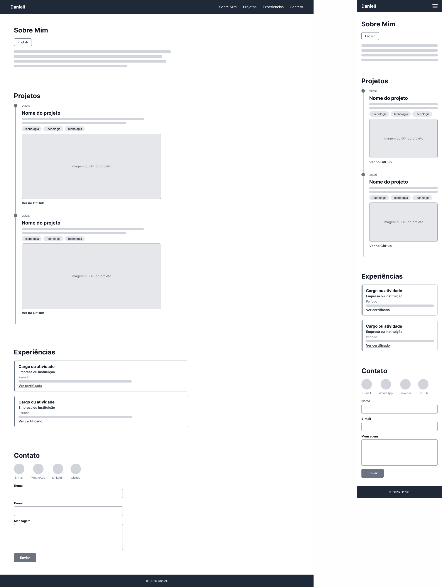

# Portfólio Profissional - Daniell Cardoso

Site de portfólio profissional desenvolvido em React para apresentar minha trajetória, projetos, experiências e formas de contato. Trabalho do Laboratório 01 da disciplina DIAW (Engenharia de Software, PUC Minas).

**Site publicado:** https://daniell-cardoso.vercel.app

## Sobre o projeto

O portfólio é uma página única, com menu de navegação que leva às quatro seções:

- **Sobre Mim:** apresentação com botão para alternar entre português e inglês.
- **Projetos:** linha do tempo com os projetos, do mais antigo ao mais recente. Cada projeto tem nome, descrição, tecnologias, link do repositório no GitHub e imagem.
- **Experiências:** experiências e formações, com link para os certificados.
- **Contato:** ícones clicáveis (e-mail, WhatsApp, LinkedIn e GitHub) e formulário com validação que envia e-mail pelo EmailJS.

## Protótipos (wireframes)

Os wireframes foram feitos no Figma, em média fidelidade. A versão Desktop está à esquerda e a versão Mobile à direita.



## Tecnologias utilizadas

- React
- Vite
- JavaScript
- CSS
- EmailJS (envio de e-mail pelo front-end)
- react-icons (ícones)
- ESLint
- Vercel (hospedagem)
- Figma (protótipos)
- Git e GitHub (versionamento)

## Dependências

Dependências de produção:

- `react` e `react-dom`
- `@emailjs/browser`
- `react-icons`

Dependências de desenvolvimento:

- `vite` e `@vitejs/plugin-react`
- `eslint` e plugins relacionados

A lista completa, com as versões, está no arquivo `package.json`.

## Estrutura de diretórios

```
portfolio/
├── docs/                      # Imagens dos wireframes
├── public/
│   ├── certificados/          # Certificados exibidos na seção Experiências
│   └── projetos/              # Imagens dos projetos
├── src/
│   ├── components/
│   │   ├── Header.jsx         # Cabeçalho e menu de navegação
│   │   ├── SobreMim.jsx       # Seção Sobre Mim (PT/EN)
│   │   ├── Projetos.jsx       # Timeline de projetos
│   │   ├── Experiencias.jsx   # Seção de experiências
│   │   ├── Contato.jsx        # Ícones e formulário de contato
│   │   └── Footer.jsx         # Rodapé
│   ├── data/
│   │   ├── projetos.js        # Dados dos projetos
│   │   └── experiencias.js    # Dados das experiências
│   ├── App.jsx
│   ├── App.css
│   ├── index.css
│   └── main.jsx
├── index.html
├── package.json
└── vite.config.js
```

## Como executar localmente

Pré-requisito: [Node.js](https://nodejs.org/) instalado.

```bash
# 1. Clonar o repositório
git clone https://github.com/daniell-2508/portfolio.git

# 2. Entrar na pasta do projeto
cd portfolio

# 3. Instalar as dependências
npm install

# 4. Iniciar o servidor de desenvolvimento
npm run dev
```

Depois, abra o endereço que aparecer no terminal (normalmente `http://localhost:5173`).

Para gerar a versão de produção:

```bash
npm run build
```

### Configuração do formulário de contato

O envio de e-mail usa o [EmailJS](https://www.emailjs.com/). Para o formulário funcionar em outra conta, crie um serviço e um template no EmailJS e preencha os valores `SERVICE_ID`, `TEMPLATE_ID` e `PUBLIC_KEY` no início do arquivo `src/components/Contato.jsx`. O template usa as variáveis `{{name}}`, `{{email}}`, `{{message}}`, `{{title}}` e `{{time}}`.

## Como atualizar o conteúdo

- **Projetos:** edite o arquivo `src/data/projetos.js` e coloque as imagens em `public/projetos/`.
- **Experiências:** edite o arquivo `src/data/experiencias.js` e coloque os certificados em `public/certificados/`.
- **Textos do Sobre Mim:** edite o objeto `textos` em `src/components/SobreMim.jsx`.

## Hospedagem

O site está hospedado gratuitamente na Vercel. A cada `git push` na branch `main`, a Vercel gera um novo deploy automaticamente.

## Autor

**Daniell Cardoso**

- GitHub: [daniell-2508](https://github.com/daniell-2508)
- LinkedIn: [daniellcardoso](https://www.linkedin.com/in/daniellcardoso/)